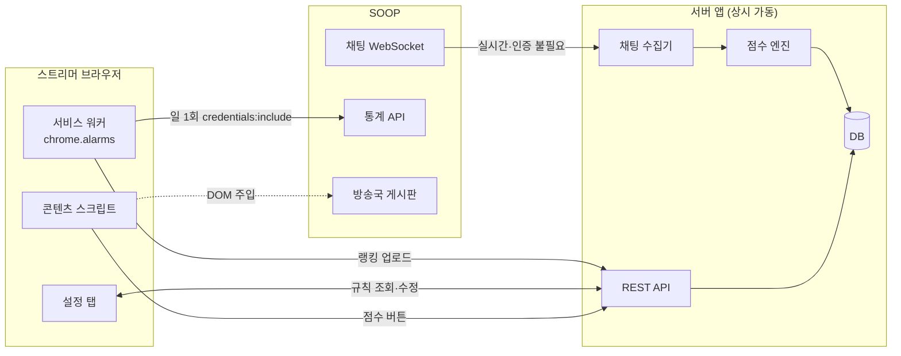
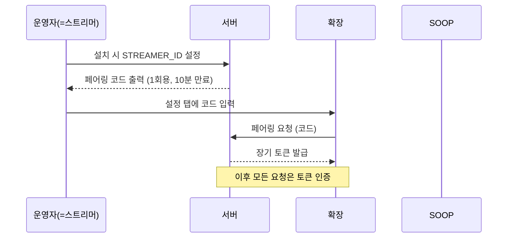
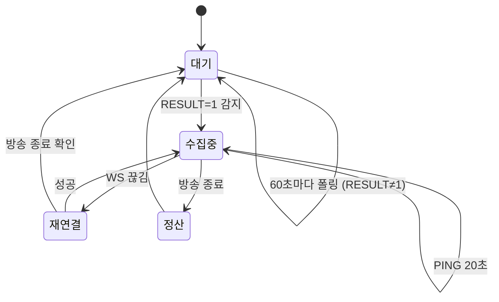

# SoopTalent 설계 문서

> 스트리머가 운영하는 시청자 활동 포인트 시스템
> 최종 갱신: 2026-08-10

---

## 1. 개요

시청자의 방송 참여 활동(시청·채팅·구독·후원·게시판)을 자동 집계해 포인트를 부여한다.
**운영 주체는 스트리머 본인**이므로, 시청자 클라이언트를 신뢰할 필요가 없다 — 모든 데이터는 SOOP 서버 또는 스트리머 권한으로 확보한다.

### 설계 원칙

| 원칙 | 의미 |
|---|---|
| **무인 운영** | 방송 시작·종료 감지, 수집, 정산, 재연결이 전부 자동. 스트리머 개입은 기능 ⑥⑦ 버튼 클릭뿐 |
| **멱등성** | 모든 적립은 `idem_key` 기반. 재연결·재처리·중복 수신에도 두 번 적립되지 않음 |
| **이벤트 소싱** | 점수를 직접 증감하지 않고 이벤트를 append. 규칙이 바뀌면 재계산 가능 |
| **서버 우선 수집** | 확장을 거치지 않고 서버가 SOOP에서 직접 받을 수 있는 것은 전부 서버가 받는다 |
| **실패해도 조용히** | 수집 실패는 자동 재시도. 스트리머에게는 복구 불가 상황만 알림 |

---

## 2. 구성 요소

구성은 **서버 앱 + 확장 프로그램** 둘뿐이다. 별도 데스크톱 클라이언트는 두지 않는다.



### 왜 클라이언트 앱이 필요 없는가

인증이 필요한 통계 API 호출은 확장의 **서비스 워커가 그대로 할 수 있다.**

```js
// manifest.json
"permissions": ["storage", "alarms"],
"host_permissions": ["https://*.sooplive.com/*"],
"background": { "service_worker": "src/background.js" }

// background.js — 탭 없이 동작
chrome.alarms.create("dailySync", { periodInMinutes: 1440 });
chrome.alarms.onAlarm.addListener(() => syncRanking());

async function syncRanking() {
  const r = await fetch(STAT_URL, { method:"POST", credentials:"include", body: ... });
  // → 서버로 업로드
}
```

`host_permissions`가 있으면 서비스 워커의 `fetch`에 SOOP 세션 쿠키가 실린다. **페이지를 띄울 필요도, 탭이 열려 있을 필요도 없다.**

> 이 패턴은 실존 확장 `SOOP 월별 리캡`(`pncpjgfglndfmeamgbfjkdabogaikmio`)에서 검증된 구조다. 해당 확장의 `background.js`가 `chrome.alarms` 1440분 주기로 깨어나 `get_private_info.php`와 통계 API를 `credentials:"include"`로 직접 호출한다.

**한계와 대응**

| 한계 | 대응 |
|---|---|
| Chrome이 완전히 종료돼 있으면 알람이 안 뜸 | 기동 시 `chrome.runtime.onStartup`에서 누락분 보충 |
| 며칠 자리를 비움 | 실행 시 **최근 7일 재조회 + upsert**. 멱등키로 중복 적립 없음 |
| SOOP 세션 만료 | 로그인 필요 알림 1건 발송 (그 외엔 침묵) |

전용 앱을 써도 "PC를 켜둬야 한다"는 제약은 동일하다. 별도 설치·업데이트 경로를 하나 더 만들 이유가 없다.

---

## 3. 신원 인증

**자체 호스팅 단일 스트리머 구성에서는 페어링 방식으로 충분하다.** 서버 운영자와 스트리머가 동일인이므로, 바인딩을 운영자가 직접 설정하면 그 자체가 신뢰의 근거가 된다.

### 최초 1회 페어링



비밀번호를 쓰지 않는다. 서버가 최초 기동 시 콘솔에 1회용 페어링 코드를 출력하고, 스트리머가 그걸 확장 설정 탭에 붙여넣으면 장기 토큰이 발급된다. 비밀번호 저장·재설정 흐름이 통째로 사라진다.

토큰은 `chrome.storage.local`에 보관한다. 확장을 뜯을 수 있는 사람은 그 PC 사용자 = 스트리머 본인이므로 문제가 되지 않는다.

> **HTTPS는 필수다.** 토큰이 평문으로 오가면 페어링의 의미가 없다. 자체 호스팅이면 Caddy + Let's Encrypt로 자동 발급받는 것이 가장 간단하다.

### 이 방식이 성립하는 조건

바인딩(`서버 계정 ↔ 스트리머 ID`)을 **운영자가 설정**해야 한다. 로그인이 증명하는 것은 *서버 계정의 통제권*이지 *SOOP 계정의 소유권*이 아니기 때문이다.

- ✅ **운영자가 설정** — 자체 호스팅. "이 서버는 내 것이고 대상은 내 채널"이라는 선언이므로 검증할 대상이 없다
- ❌ **가입자가 자기 신고** — 아무나 임의의 스트리머 ID를 주장할 수 있다. SaaS라면 이 방식은 성립하지 않는다

### 오설정 방지 (실질적인 안전장치)

실제로 자주 발생하는 문제는 공격이 아니라 **브라우저가 다른 SOOP 계정으로 로그인된 상태**다. 양쪽에서 막는다.

```js
// 확장: 동기화 직전 확인
const me = await getPrivateInfo();           // CHANNEL.LOGIN_ID
if (me.id !== boundStreamerId) {
  notify("SOOP 로그인 계정이 설정과 다릅니다");
  return;                                     // 업로드 중단
}
```

```
서버: 업로드 페이로드의 대상 ID != 바인딩된 STREAMER_ID → 거부 + 로그
```

SOOP 통계 API 자체도 세션 쿠키와 `szId`를 함께 보므로, 계정이 어긋나면 애초에 원하는 데이터가 나오지 않는다. 위 검사는 그 실패를 조용한 오작동이 아니라 **명시적 알림**으로 바꾸는 역할이다.

> **SaaS로 확장한다면** 이 절차로는 부족하다. 그때는 서버가 발급한 nonce를 스트리머가 자기 방송국 소개글에 게시하고 **서버가 확장을 거치지 않고 SOOP에서 직접 읽어 확인**하는 소유권 증명이 필요하다.

### 공격 표면이 애초에 작다

점수의 대부분은 **확장을 거치지 않는다.**

| 기능 | 경로 | 확장 위조 가능? |
|---|---|---|
| ② 체류 | 서버 ← WS `0004` | ❌ 불가 |
| ③ 채팅 | 서버 ← WS `0005` | ❌ 불가 |
| ④ 구독 | 서버 ← WS | ❌ 불가 |
| ⑤ 팬가입·후원 | 서버 ← WS | ❌ 불가 |
| ① 랭킹 가산점 | 확장 중계 | ⚠️ 가능 |
| ⑥⑦ 게시판·댓글 | 확장 트리거 | ⚠️ 가능 |

서버가 채팅 WebSocket에 직접 붙어 있으므로 ②③④⑤는 확장이 개입할 여지가 없다. 위조 여지가 있는 것은 ①과 ⑥⑦뿐이다.

### ①의 교차검증

**채팅 랭킹은 서버가 자체 계산할 수 있다.** 서버가 이미 모든 채팅을 수신하고 있으므로 SOOP 랭킹과 대조 가능하다. 두 값이 크게 어긋나면 업로드를 거부하고 로그를 남긴다.

시청시간 랭킹만 SOOP에 의존하는데, 이것도 `presence` 테이블의 체류 기록과 순위 상관을 비교해 이상치를 잡을 수 있다.

### ⑥⑦은 방어 대상이 아니다

스트리머 본인이 자기 서버에서 자기 시청자에게 점수를 주는 행위다. 막을 이유가 없다. 다만 **실수 방지**는 필요하다 — 글 ID를 멱등키로 써서 같은 글에 두 번 주지 못하게 하고, 30일 내 취소를 허용한다.

> 이 시스템을 여러 스트리머에게 SaaS로 제공한다면 전제가 달라진다. 그때는 ①을 확장 중계로 받지 말고, 서버가 스트리머의 위임 토큰으로 직접 조회하는 구조가 필요하다.

---

## 4. 데이터 소스

| 소스 | 엔드포인트 | 제공 정보 | 상태 |
|---|---|---|---|
| 채팅 서버 조회 | `live.sooplive.com/afreeca/player_live_api.php` | `CHDOMAIN`, `CHPT`, `CHATNO`, `BNO` | ✅ 확인 |
| 실시간 채팅 | `wss://{CHDOMAIN}:{CHPT+1}/Websocket/{bid}` | 채팅·입장·시청자목록 | ✅ 확인 |
| 일별 랭킹 | `broadstatistic.sooplive.com/api/nonlive_statistic.php`<br>`szModule=RankViewTimeData&szMethod=rank` | 순위/유저ID/참여시간(시:분), **100위까지** | ⚠️ 스키마 확인, 실데이터 미검증 |
| 게시글 | `api-channel.sooplive.com/v1.1/channel/{bid}/post/{titleNo}` | `titleNo`, `userId`, `userNick` | ✅ 확인 |
| 댓글 | `.../post/{titleNo}/comment?page=1&orderBy=reg_date&cCommentNo=0` | `pCommentNo`, `userId`, `userNick`, `comment` | ✅ 확인 |

### 방송국 페이지 URL

```
방송국    https://www.sooplive.com/station/{bid}
게시판    /station/{bid}/board/{bbsNo}
게시글    /station/{bid}/post/{titleNo}     ← titleNo가 그대로 멱등키
```

> ⚠️ **게시판 DOM을 스크래핑하지 않는다.** 방송국 페이지는 CSS Modules SPA라
> 클래스명이 빌드마다 바뀌는 해시(`__soopui__X-module__y___a1B2c`)이고,
> 작성자 ID를 담은 속성이 없다.
> 유저 ID와 글 번호는 **전부 API에서** 가져오고, DOM은 버튼을 끼울 위치를 찾는 데만 쓴다.
> UI가 바뀌면 버튼이 안 보일 뿐, 엉뚱한 사람에게 점수가 가지 않는다.

### 채팅 프로토콜 (실측)

```
패킷 = ESC(0x1b) + TAB(0x09) + svc(4자리) + bodyLen(6자리) + "00" + body
body 필드 구분자 = 0x0c  (앞뒤에도 붙으므로 split 시 빈 문자열 발생)
```

**접속 절차**

```
1. CONNECT  svc=1  body = F F "16" F F F
2. (0001 ack 수신)
3. JOIN     svc=2  body = F {CHATNO} F F F F F
4. PING     svc=0  body = F           ← 20초 주기
```

**확인된 svc 코드**

| svc | 의미 | 필드 |
|---|---|---|
| `0004` | **시청자 목록** | `[id, nick, flag]` 3개씩 반복. 실시간 계속 갱신 |
| `0005` | **채팅** | `[1]`메시지 `[2]`유저ID `[6]`닉네임 `[7]`flag `[8]`팬클럽주차 |
| `0012` | **입장** | `[2]`유저ID `[3]`닉네임 |
| `0013` | **퇴장** | `[1]`유저ID `[4]`닉네임 |
| `0018` | **별풍선 후원** | `[2]`후원자ID `[3]`닉네임 `[4]`**개수** |
| `0093` | **구독 (추정)** | `[2]`유저ID `[3]`닉네임 `[4]`개월수? `[6]`미상 |
| `0087` | **애드벌룬 후원** | `[3]`후원자ID `[4]`닉네임 `[8]`아이템 이미지 URL `[10]`**개수** |
| `0104` | 공지사항 | `[4]`공지문구 |
| `0109` | **이모티콘 채팅** | `[6]`유저ID `[7]`닉네임 `[13]`팬클럽주차 |
| `0127` | 팬클럽 정보 | `fw=45&afw=45` 반복 |
| `0054` `0090` `0094` `0110` | 미상 (접속 직후 1회) | |

> **후원은 코드가 둘이고 필드 배치가 다르다.** 별풍선은 `0018`(개수 `[4]`), 애드벌룬은 `0087`(개수 `[10]`).
> 하나로 뭉뚱그려 파싱하면 애드벌룬이 전부 어긋난다.
>
> **`0093`이 구독이라는 것은 단일 샘플 기반 추정이다.** `[1]~[3]`이 스트리머·유저·닉인 것은 후원 패킷과
> 같은 배치라 확실하나, `[4]`가 개월 수라는 근거는 `[7]`에 같은 값이 반복된다는 것뿐이다.
> 그래서 파서는 **개월 수가 1~600 범위를 벗어나면 적립하지 않는다** — 해석이 틀렸을 때
> 말도 안 되는 점수가 나가는 것을 막는다.
>
> **팬가입은 별도 이벤트 코드가 없다.** `0127`과 채팅 패킷의 주차 필드로 *상태*만 알 수 있으므로
> `-1 → 양수` 전환을 관측해 추론한다. **첫 관측은 기준선으로만 기록하고 적립하지 않는다** —
> 그러지 않으면 이미 오래된 팬 전원에게 가입 점수가 나간다.

> **팬클럽 주차는 채팅 패킷만으로 알 수 있다.** `0005`의 `[8]`이 `0127`의 `fw` 값과 일치함을 확인했다. `-1`이면 미가입.
> 유저ID의 `(2)`, `(3)` 접미사는 동일 계정 중복 접속 수이므로 **정규화 시 제거**해야 한다.

> ⚠️ **`tile.json`은 사용하지 않는다.** CDN 서명 URL이라 만료되면 401이다. `svc 0004`가 토큰 없이 같은 정보를 실시간으로 준다.

---

## 5. 기능별 설계

### ① 일별 참여시간·채팅 랭킹 가산점

매일 새벽, 전날 **상위 100명**에게 순위별 가산점.

- **소스**: `RankViewTimeData` (확장 서비스 워커가 조회 → 서버 업로드)
- **시점**: 매일 07:00. SOOP 통계는 전날 데이터를 06시경 확정하므로 여유를 둔다
- **누락 대비**: 실행 시 최근 7일 재조회 후 upsert

```
가산점 = ceil(BONUS_TOP * (1 - (rank-1)/100))
기본값 BONUS_TOP = 100  → 1위 100점, 50위 51점, 100위 1점
```

참여시간 랭킹과 채팅 랭킹을 각각 계산해 합산한다. 채팅 랭킹은 §3의 교차검증을 통과해야 반영된다.

### ② 실시간 체류 점수

- **소스**: `svc 0004`
- **핵심 주의**: `0004`는 전체 목록을 **여러 패킷에 나눠 반복 송신**한다(2.4만 시청자 방송에서 25초에 3211패킷). 단일 패킷을 스냅샷으로 착각하면 안 된다

```
롤링 윈도우 방식:
  30초 동안 수신한 0004의 유저 ID를 합집합 → 그 시점의 접속자 집합
  집합을 presence 테이블에 반영 (last_seen 갱신)
  120초 이상 미등장 → 세션 종료
  세션 지속 중 10분마다 STAY_POINT 지급
```

### ③ 채팅당 점수

- **소스**: `svc 0005`
- **어뷰징 방지** (도배 파밍 차단):

| 규칙 | 기본값 |
|---|---|
| 최소 길이 | 2자 이상 |
| 직전 메시지와 동일 | 제외 |
| 분당 점수 인정 상한 | 3회 |
| 일일 채팅 점수 상한 | 200점 |

### ④ 구독 개월수 점수

- **소스**: 채팅 이벤트 (**svc 코드 미확인**)
- 확인 전까지는 미지의 svc 코드를 **전부 원본 저장**해두고, 코드가 특정되면 저장된 로그를 재처리해 소급 적립한다

```
점수 = SUB_BASE + SUB_PER_MONTH * min(개월수, 24)
```

### ⑤ 팬가입·후원 점수

- **팬가입**: `svc 0005`의 `[8]` 값이 `-1` → 양수로 바뀌는 시점을 감지. **즉시 구현 가능**
- **후원**: svc 코드 미확인. ④와 동일하게 원본 저장 후 소급 처리

```
후원 점수 = floor(별풍선 개수 * DONATION_RATE)
```

### ⑥⑦ 게시판 글·댓글 수동 점수 버튼

- 콘텐츠 스크립트가 게시글/댓글 DOM에 `+점수` 버튼 주입
- 클릭 → 작성자 ID + 글 ID를 서버로 전송
- **글 ID를 멱등키로 사용**, 30일 내 취소 가능

---

## 6. 설정 UI (확장 탭)

점수 기준은 확장의 설정 탭에서 조정한다.

```js
// manifest.json
"options_page": "src/settings.html"     // chrome://extensions 에서 열림
"action": { "default_popup": "src/popup.html" }   // 아이콘 클릭 시 요약 + 설정 진입
```

> **규칙의 원본은 서버에 둔다.** 확장은 서버 API를 읽고 쓰는 UI일 뿐이다. 규칙이 확장 로컬에 있으면 브라우저를 바꿀 때 날아가고, 점수 엔진(서버)이 참조할 수도 없다.

```
GET  /api/rules        → 현재 규칙 전체
PUT  /api/rules        → 변경 (인증 토큰 필요)
POST /api/rules/reset  → 기본값 복원
```

**설정 화면 구성**

| 섹션 | 항목 |
|---|---|
| 체류 | 지급 주기(분), 회당 점수, 세션 유지 유예(초) |
| 채팅 | 건당 점수, 최소 길이, 분당 인정 상한, 일일 상한 |
| 랭킹 | 1위 점수, 반영 여부(참여시간/채팅 각각) |
| 구독·후원 | 기본 점수, 개월당 점수, 별풍선 환산율 |
| 팬가입 | 최초 가입 점수 |
| 수동 | 게시글·댓글 기본 점수 |

전 항목에 기본값이 있고, 아무것도 건드리지 않아도 동작한다. 변경 시 **적용 시점 이후 이벤트에만** 반영하고 과거는 재계산하지 않는다(원하면 재계산 버튼 제공 — 이벤트 소싱이라 가능).

---

## 7. 점수 엔진

### 이벤트 소싱

```sql
CREATE TABLE point_events (
  id          BIGSERIAL PRIMARY KEY,
  user_id     TEXT NOT NULL,          -- (2) 접미사 제거된 정규화 ID
  kind        TEXT NOT NULL,          -- rank_watch | rank_chat | stay | chat
                                      -- | subscribe | fanclub | donation
                                      -- | board_post | board_comment
  amount      INTEGER NOT NULL,
  occurred_at TIMESTAMPTZ NOT NULL,
  idem_key    TEXT NOT NULL UNIQUE,
  broad_no    BIGINT,
  meta        JSONB,
  created_at  TIMESTAMPTZ DEFAULT now()
);

CREATE INDEX ON point_events (user_id, occurred_at DESC);
CREATE INDEX ON point_events (kind, occurred_at DESC);
```

### 멱등키 규칙

| 이벤트 | idem_key |
|---|---|
| 일별 랭킹 | `rank:{watch\|chat}:{date}:{user_id}` |
| 체류 | `stay:{broad_no}:{user_id}:{tick_index}` |
| 채팅 | `chat:{broad_no}:{user_id}:{minute}:{seq}` |
| 구독/후원 | `{kind}:{broad_no}:{user_id}:{event_hash}` |
| 게시판 | `board:{post_id}` / `comment:{comment_id}` |

### 원본 로그 (소급 처리용)

```sql
CREATE TABLE raw_chat_events (
  id        BIGSERIAL PRIMARY KEY,
  broad_no  BIGINT NOT NULL,
  svc       TEXT NOT NULL,
  parts     JSONB NOT NULL,
  raw       BYTEA,
  recv_at   TIMESTAMPTZ NOT NULL
);
CREATE INDEX ON raw_chat_events (svc, recv_at DESC);
```

**미지의 svc 코드는 전부 여기 저장한다.** 후원·구독 코드가 특정되면 재처리해 소급 적립한다. 초기 운영에서 가장 중요한 안전장치다.

### 기타 테이블

```sql
CREATE TABLE presence (
  broad_no   BIGINT, user_id TEXT,
  started_at TIMESTAMPTZ, last_seen TIMESTAMPTZ,
  ticks_paid INTEGER DEFAULT 0,
  PRIMARY KEY (broad_no, user_id)
);

CREATE TABLE users (
  user_id    TEXT PRIMARY KEY,
  nickname   TEXT,
  fanclub_weeks INTEGER DEFAULT -1,
  first_seen TIMESTAMPTZ, last_seen TIMESTAMPTZ
);

CREATE TABLE broadcasts (
  broad_no BIGINT PRIMARY KEY,
  title    TEXT, started_at TIMESTAMPTZ, ended_at TIMESTAMPTZ
);

CREATE TABLE scoring_rules (
  key TEXT PRIMARY KEY, value JSONB, updated_at TIMESTAMPTZ
);

CREATE TABLE streamer_identity (        -- §3 신원 인증
  streamer_id   TEXT PRIMARY KEY,      -- 운영자가 설치 시 설정
  token_hash    TEXT NOT NULL,         -- 페어링으로 발급된 장기 토큰
  paired_at     TIMESTAMPTZ,
  pairing_code  TEXT,                  -- 1회용, 사용 시 NULL
  code_expires  TIMESTAMPTZ
);
```

```sql
CREATE MATERIALIZED VIEW user_points AS
SELECT user_id, SUM(amount) AS total, MAX(occurred_at) AS last_earned
FROM point_events GROUP BY user_id;
```

---

## 8. 무인 운영



- `player_live_api.php`를 60초마다 폴링해 방송 시작을 자동 감지
- WS 끊김 시 지수 백오프(1s → 2s → 4s … 최대 60s) 재연결. `CHDOMAIN`/`CHATNO`는 방송마다 바뀌므로 재조회
- 방송 종료 시 presence 세션 마감 및 미지급 tick 정산

**스트리머에게 알리는 경우** (그 외엔 침묵)

- 확장의 SOOP 세션 만료 → 재로그인 요청
- 서버 연결 실패 24시간 지속
- 방송 중인데 채팅 수집이 10분 이상 끊김

---

## 9. 미확정 항목

| 항목 | 확인 방법 | 우선순위 |
|---|---|---|
| 후원·구독 svc 코드 | `raw_chat_events`에 미지 코드 축적 후 실제 후원 시점과 대조 | 높음 |
| `RankViewTimeData` 실데이터 | 방송 다음날 06시 이후 조회. `nPage` 동작 여부 확인 | 높음 |
| flag 비트필드 매핑 | `589856\|163840` 형태. 구독·매니저·열혈 비트 위치 파악 | 중간 |
| 게시판/댓글 DOM·API | 확장 개발 시 실제 페이지 관찰 | 중간 |
| `0004` 전체 목록 1주기 소요 시간 | 유저 집합 수렴 시간 측정 → 롤링 윈도우 크기 확정 | 중간 |

---

## 10. 로드맵

**1단계 — 뼈대**
서버 앱 + 채팅 WS 수집기 + `raw_chat_events` 저장. 점수 계산은 아직 안 함.
→ 이 단계부터 후원·구독 코드 확정에 필요한 데이터가 쌓인다.

**2단계 — 확정 기능**
③ 채팅 점수, ② 체류 점수, ⑤ 팬가입 감지. 확인된 프로토콜만 사용.

**3단계 — 확장 + 페어링**
§3 페어링 절차, ① 일별 랭킹, §6 설정 탭.

**4단계 — 미확인 이벤트**
④ 구독, ⑤ 후원. 1단계부터 쌓인 원본 로그를 소급 처리.

**5단계 — 수동 기능**
⑥⑦ 게시판·댓글 버튼.

---

## 부록: 기본 점수표

| 항목 | 기본값 |
|---|---|
| 체류 10분당 | 5점 |
| 채팅 1건 | 2점 (분당 3건, 일 200점 상한) |
| 팬클럽 가입 | 500점 (최초 1회) |
| 구독 | 300점 + 개월당 50점 (최대 24개월) |
| 후원 | 별풍선 1개당 10점 |
| 일별 랭킹 1위 | 100점 (100위까지 선형 감소) |
| 게시글 (수동) | 50점 |
| 댓글 (수동) | 10점 |

모든 값은 설정 탭에서 변경 가능하며, 미설정 시 위 기본값으로 동작한다.
